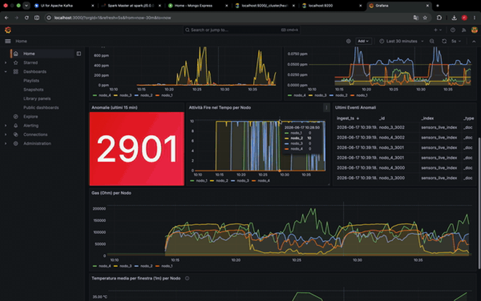
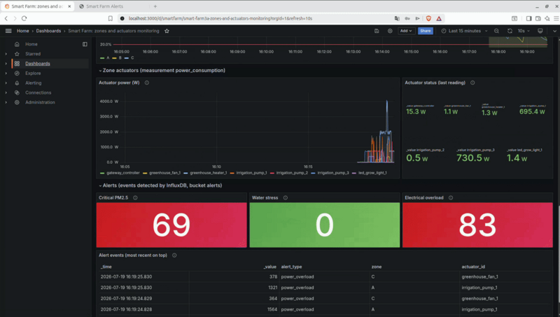
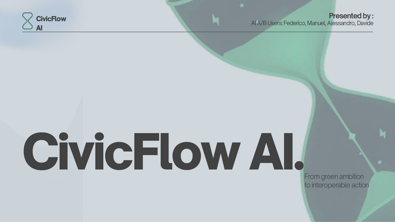
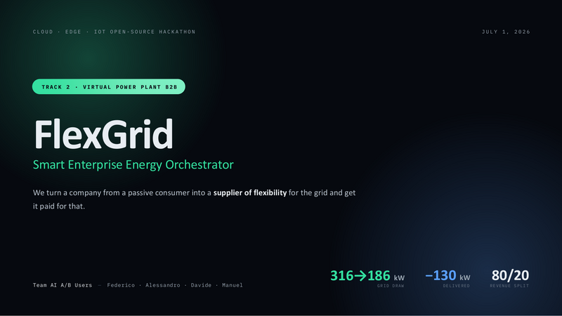
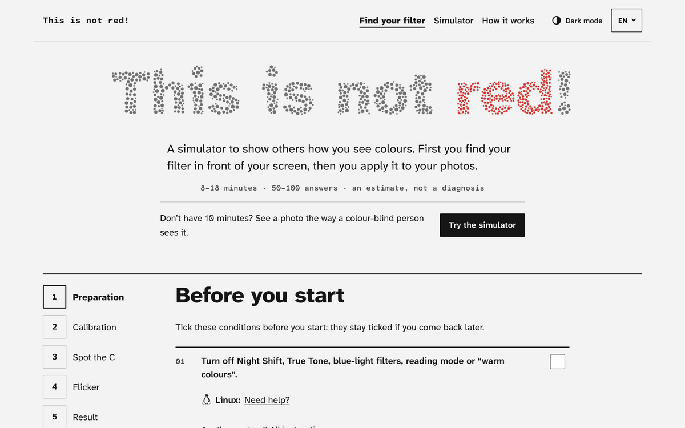

# Hi, I'm Federico 👋

I'm currently doing my **MSc in Computer Science** at the **University of Cagliari**, where I'm working on data engineering, LLM agents, retrieval-augmented generation and reinforcement learning.

## 🔍 Interests

- Data engineering and real-time streaming pipelines
- IoT and cloud-edge systems
- LLM agents and RAG
- Reinforcement learning

## 🛠️ Projects

*You can also find my main projects pinned below.*

### Data Engineering & IoT

<table>
  <tr>
    <td width="40%"></td>
    <td width="60%">
      <h3><a href="https://github.com/AleFlu/Big_Data">IoT Streaming Pipeline</a></h3>
      
Real-time fire and anomaly detection on 4 sensor nodes, built on a Lambda architecture with a streaming layer and a batch layer. Big Data course project.

      
<code>Kafka</code> <code>Spark</code> <code>Elasticsearch</code> <code>MongoDB</code> <code>Grafana</code> <code>Docker</code>

    </td>
  </tr>
  <tr>
    <td width="40%"></td>
    <td width="60%">
      <h3><a href="https://github.com/ChiccoSechi/SmartFarm">SmartFarm</a></h3>
      
Real-time pipeline for a smart farm: simulated sensors over MQTT, anomaly alerts computed inside the database, live dashboards.

      
<code>MQTT</code> <code>Telegraf</code> <code>InfluxDB</code> <code>MongoDB</code> <code>Grafana</code>

    </td>
  </tr>
</table>

### Hackathon Projects

<table>
  <tr>
    <td width="40%"></td>
    <td width="60%">
      <h3><a href="https://github.com/AleFlu/civicflow-ai-cei-hackathon">CivicFlow AI</a></h3>
      
LLM agent that turns a city's green-mobility goals into an interoperability model (stakeholders, capabilities, standards) as JSON, with a guardrail that rejects invented standards.

      
<code>Java</code> <code>Jakarta EE</code> <code>LLM agents</code> <code>Tool calling</code>

    </td>
  </tr>
  <tr>
    <td width="40%"></td>
    <td width="60%">
      <h3><a href="https://github.com/Bacchiu/flexGrid-cei-hackathon">FlexGrid</a></h3>
      
Virtual power plant aggregator that modulates a company's PV, EV chargers and HVAC in response to grid signals, orchestrated from edge to cloud.

      
<code>FastAPI</code> <code>Kubernetes</code> <code>OpenSlice</code> <code>Docker</code>

    </td>
  </tr>
</table>

### Web Apps

<table>
  <tr>
    <td width="40%"></td>
    <td width="60%">
      <h3><a href="https://github.com/Bacchiu/ThisIsNotRed">This is not red!</a></h3>
      
A colour vision test you take at home that estimates the type and strength of colour blindness, plus a simulator that shows others how you see colours. 6 languages, works offline, no third-party resources.

      
<a href="https://thisisnotred.pages.dev/">Live site</a>

      
<code>JavaScript</code> <code>HTML/CSS</code> <code>Python</code> <code>Accessibility</code>

    </td>
  </tr>
</table>

### LLMs and RAG
- [UniRAG](https://github.com/ChiccoSechi/unirag): Telegram bot that answers questions about the UniCa CS Master's degree using only official sources, built on Cloudflare (Workers AI, Vectorize, D1).

### Others
- [Dungeon Shooter](https://github.com/matteodei/Progetto_VGD): dungeon shooter in Unity and C#, built as a team for the Video Game Design course.
